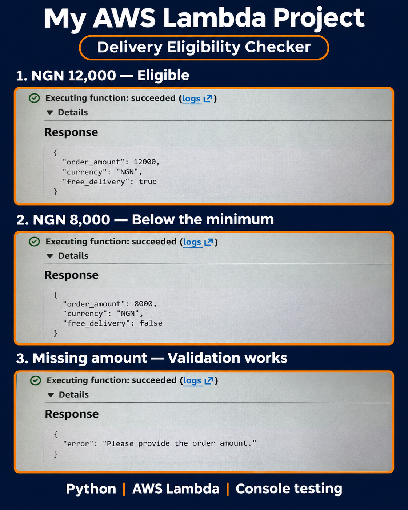

# AWS Lambda Delivery Eligibility API

A serverless delivery eligibility API built with Amazon API Gateway, AWS Lambda, and Python.

## What the project does

The API checks whether an order qualifies for free delivery.

Orders of NGN 10,000 or more qualify. Missing, nonnumeric, and negative amounts receive validation messages.

## Technologies used

- Amazon API Gateway HTTP API
- AWS Lambda
- Python 3.14
- AWS CloudShell
- curl and JSON

## How it works

1. A client sends an order to POST /check-delivery.
2. API Gateway passes the request to Lambda.
3. Lambda reads and validates the order amount.
4. Lambda checks the NGN 10,000 threshold.
5. API Gateway sends the HTTP response back to the client.

## AWS configuration

| Setting | Value |
|---|---|
| Region | us-east-1 |
| API name | delivery-eligibility-api |
| Route | POST /check-delivery |
| Lambda function | delivery-eligibility-check |
| Runtime | Python 3.14 |
| Handler | lambda_function.lambda_handler |
| Stage | $default |
| Automatic deployment | Enabled |

## Example request body

    {
      "order_amount": 12000
    }

## Example HTTP response

Status 200

    {
      "order_amount": 12000,
      "currency": "NGN",
      "free_delivery": true
    }

## Verified API tests

These requests were sent using curl in AWS CloudShell.

| Input | HTTP status | Observed result |
|---|---|---|
| NGN 12,000 | 200 | free_delivery is true |
| NGN 8,000 | 200 | free_delivery is false |
| Missing amount | 400 | Please provide the order amount. |

HTTP 200 means a valid order was processed, including orders that do not qualify for free delivery.

HTTP 400 means the submitted input needs correcting.

## Additional console tests

Before adding API Gateway, I also verified that an order of exactly NGN 10,000 qualifies and that a negative amount returns a validation message.

## Try the API

Replace YOUR_INVOKE_URL with the invoke URL of your deployed API.

    curl -i -X POST 'YOUR_INVOKE_URL/check-delivery' \
      -H 'Content-Type: application/json' \
      -d '{"order_amount":12000}'

## Deployment overview

1. Create a Python Lambda function.
2. Paste the contents of lambda_function.py into the Lambda editor.
3. Set the handler to lambda_function.lambda_handler and deploy.
4. Create an API Gateway HTTP API with a Lambda integration.
5. Configure POST /check-delivery to use the function.
6. Deploy using the $default stage.
7. Test requests using curl.

## Lambda console testing

Direct JSON test events are also supported.

The console response includes statusCode, headers, and body.
The body contains the JSON delivery result or validation message.

## Project image

## Current scope

The function has been deployed and tested through both the Lambda console and API Gateway.
